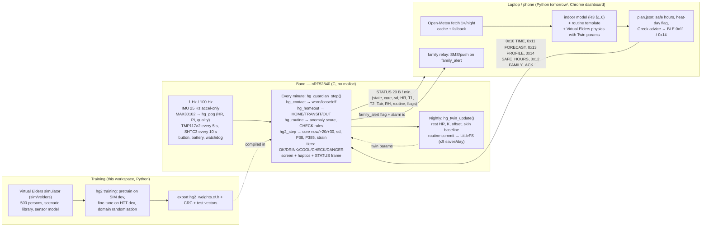

# Heat Guardian AI sprint — ARCHITECTURE

*Architect, 12 Nov 2026. Read after `/home/claude/hg_ai/BRIEF.md`. Every builder and tester reads this file in full. Where this file and a builder brief disagree, this file wins; where this file and the research files disagree, the research file wins and the builder reports the conflict in its delivery report.*

Research inputs (verified by reading them, not summaries): R1 `/home/claude/hg_ai/research/R1_ageing_physiology.md`, R2 `R2_heatflux_and_wrist_sensing.md`, R3 `R3_indoor_routine_forecast.md`, R4 `R4_onchip_ml_ble_firmware.md`; the v1.2 model `/home/claude/hgmodel/REPORT.md` + `heat_guardian_model.h` + `heat_guardian_band.c`; the data store `/home/claude/hgdata/DATA_SUMMARY.md` + `schema.md` + `DATASET_NOTES.md`; the firmware `/home/claude/hg_fw/07_all_parts/07_all_parts.ino` and the R4 PoCs in `/home/claude/hg_ai/fw/poc_*`.

---

## 0. The ten decisions this architecture rests on

| # | Decision | Why (source) |
|---|---|---|
| D1 | **Core Sense is not a wrist core thermometer.** It is a fusion of insulated wrist skin (T1), the flux term (T1−T2, valid only below ~31 °C room air), the HR Kalman anchor (v1.2 ECTemp, the only part validated on real people), air T/RH, motion and a personal K/offset. It outputs a core *estimate with an ensemble spread* and a *strain index*; alarms use the spread. | R2 §1.4, §2.2 (ΔT collapses to 0.3–0.6 °C at 34–36 °C rooms), §7.2, §7.6; REPORT §5b (Danger is a strain signal, not a thermometer) |
| D2 | **The REF TMP117 is optional at runtime.** Every model and every C function takes `t_ref_c = NAN` and a `flux_valid` flag; training randomises the flux channel off 30 % of the time. The product brief lists the REF board as an open item ("fit or drop"); the physics says it adds little in the regime that kills people. | PRODUCT_BRIEF §6 (Nov 12 update); R2 §2.2 table |
| D3 | **Physics: Gagge–Ji two-node, re-implemented in numpy as a stateful 1-min multi-day model**, met 0.86 seated / 1.37 ADL, age effect = higher sweat thresholds (37.0/34.3 °C) + hard ω_max cap drawn per person from 0.31–0.57, SkBF ceiling 63, κ (HR per °C core) swept 14–30 bpm/°C. Not JOS-3 (wrong sign on humid-heat age effect). | R1 §1.4, §1.6, §2.1, §2.3, §7.4, §8.1, §8.3; REPORT §7 |
| D4 | **New sealed set = SEALED-SIM (100 held-out virtual persons, unseen parameter draws) + SEALED-OFFICE (5 of 19 office subjects, dataset 16, never scored by anyone) + the Nov 16–18 wear test.** HTT (all 65) is dev for hg2. Datasets 4/7/9 were printed once by the v1 run (`results_core_external.csv`) and are *not* sealed; they are an "external check" set, reported with that label. | REPORT §2 (results_core_external.csv was looked at); DATA_SUMMARY (dataset 16 never used); BRIEF sealed-exam rule |
| D5 | **One network, 32 inputs → 24 → 16 → 6, 5-member ensemble, float32, plain C (R4 PoC code), ≈ 26 KB flash, ≈ 0.5 ms.** Outputs: core now, core +20, core +30, logit P(core ≥ 38.0 within 30 min), logit P(core ≥ 38.5 within 30 min), strain index 0–10. No expf on the band: logits compared with pre-computed cuts; sigmoid via a 33-entry table for display only. | R4 A2 (measured 32,984 B for 24-32-16-3 × 5); BRIEF item 8 |
| D6 | **Alarm thresholds stay v1.2 unless R1 gives a better-sourced number; one is replaced**: the PSU environmental limit line becomes the trial-level fits (older ADL `Pa = 8.048 − 0.1399·T`, older Rest `Pa = 8.308 − 0.1370·T`), selected by the wearer's activity in the last 30 min. The diuretic margin is kept at 0.10 °C on Drink-water only and relabelled a *hydration proxy*. | R1 §3.1 (prefer individual-trial fits; new Rest condition), §5 (diuretics: no core effect, Hospers 2024) |
| D7 | **Uncertainty rule:** the 20-min forecast used by the watch tiers is `f20_eff = mean_20 + 1.0·sd_20` (sd = ensemble std, cap +0.30 °C). Disagreement moves the warning earlier; it never moves it later. Coverage of the ±1.645·sd interval is a reported, sealed number. | R2 §3 (Strickland 2025: Kalman variances under-dispersed; ensemble/conformal is the published way); BRIEF item 6 |
| D8 | **Danger = (v1.2 logistic P(core ≥ 38.5) ≥ 0.19 for 2 min) OR (NN logit P(≥38.5 in 30 min) ≥ cut_385) OR behaviour path, the OR-rule jointly re-calibrated on HTT dev to ≤ 0.10 false/h**, followed by the button check. Routine anomalies and the impact+stillness signature go to the **CHECK** path, never straight to the family. Fall detection is not claimed. | REPORT §5b, §5c; R3 §3.4, §3.5, §6.4 |
| D9 | **Body Twin learns four things on the band, nightly, bounded**: resting HR (night-floor), personal K (flux constant, only from oral readings), personal core offset (same-day thermometer, 2-day half-life), personal night wrist-skin baseline per hour. Sweat capacity is **not** learnable without a sweat sensor; it is a profile prior for the Tomorrow Engine, settable from the phone. | REPORT §5b (same-day reading helps, other-day does not; learned rest HR changes nothing measurable); R2 §2.5, §3 (personalisation is where the wrist gains) |
| D10 | **08_logger ships first (Monday Nov 16), logs 1 Hz to the 2 MB QSPI flash (`ExternalFileSystem`) + BLE UART; internal LittleFS (28 KB) holds only the Twin/routine file.** Everything else can slip a day; the wear test cannot. | R4 A3 (28 KB internal, 10 k erase cycles; 1-min log belongs elsewhere), core library list |

---

## 1. System diagram

### 1.1 In words

**On the band (nRF52840, Arduino, C), three clocks:**

- **Every second (and 100 Hz inside the PPG bursts):** read the IMU at 25 Hz accel-only (gyro off); run `hg_ppg` on the MAX30102 IR stream during its 30 s-every-2-min duty window (continuous while any tier ≥ Drink-water is on); read both TMP117 one-shot every 5 s back-to-back, SHTC3 every 10 s; keep a 10-min ring of 5-s temperatures for the contact check; service the button (short = OK, long ≥ 2 s = HELP); feed the watchdog.
- **Every minute (`hg_guardian_step`, the Guardian Loop):** build the 1-min summaries → contact self-check (`worn/loose/off`) → home/out state → routine profile update + anomaly score → `hg2_step` (Core Sense: KF anchor + 32 features + 5-member ensemble) → tier logic (OK / Drink / Cool / CHECK / Danger) with debounce, hold and medication margins → screen + haptics → 20-byte STATUS frame over BLE → 1-min record into the 24 h RAM ring.
- **Nightly (first 30 still minutes after 03:00, once per day):** Body Twin update (`hg_twin_update`), routine profile commit, one LittleFS save (≤ 5 saves/day), time-sync bookkeeping.

**On the laptop/phone (Python `tomorrow/`, and the Chrome Web-Bluetooth dashboard):** one Open-Meteo fetch per night (cached; fallback to last night's file), indoor model (R3 §1.6) → 24 h simulation of tomorrow with the Virtual Elders physics using the wearer's Twin parameters and routine template → safe-hours plan + heat-day flag + Greek advice → BLE frames 0x11 (forecast chunks) and 0x14 (safe-hours bitmap) → band. The phone also relays family alerts (it is a silent relay: the band's `family_alert` flag + alarm id → SMS/push) and sets the profile (0x13) and time (0x10).

**Data flow over BLE (R4 A5, unchanged):** custom service `7A4E0000-…`; STATUS notify 20 B once a minute and on every state change; CMD write ≤ 20 B; INFO read 20 B (fw version, NN CRC, boot count, reset reason, twin save_count). BLEUart kept as the debug console and as the 1 Hz logger stream in `08_logger`.

### 1.2 Mermaid



---

## 2. Honest scientific position (one page)

**What wrist heat-flux can and cannot do (R2).** Dual- and single-heat-flux methods cancel the tissue resistance *perpendicular* to the probe. On the forehead and sternum that is enough (bias 0–0.2 °C, SD 0.2–0.35 °C). At the wrist the dominant unknown is the *axial* temperature drop along the arm, set by skin blood flow, which no flux formula sees; published wrist results reach MAE ≈ 0.30 °C **only with daily personal calibration and a perfusion term** (Shan 2022) and 0.34 °C free-living with ML (CALERA, LoA −0.67..+0.93 °C). Worse for our use: in rooms at 34–36 °C the skin-to-air flux is ~zero, ΔT across 3 mm of foam is 0.3–0.6 °C, and a 0.05 °C chip mismatch is a 10–15 % flux error. **Therefore Core Sense is framed, in every document and in the pitch, as "insulated wrist temperature + a small flux term below 31 °C + heart-rate anchor + air, fused by a small network, with a personal constant learned on the wearer", and its number is shown with a range.** The strain index and the alarm probabilities, not the absolute temperature, are the product. A fixed-K formula is never used raw: the band clamps `core_flux ∈ [T1, T1 + 2.5]` and gates `flux_valid = (T1 − T2 > 0.15) ∧ (T_air < T1 − 0.5)` (R2 §7.6).

**What the HR anchor can claim (REPORT).** On 13 sealed young adults walking in a hot chamber, the v1.2 Kalman + linear model estimated core to 0.25 °C MAE (CI 0.19–0.31), warned 18/21 of 38.0 °C events a median 20 min early at 0.12 false/h, and the v1.1 probability Danger caught 25/33 dev events at 0.10 false/h. That exam is spent. hg2 inherits the Kalman anchor unchanged and must *not* be worse than it on HTT dev (leave-one-subject-out); that is a dev number, labelled DEV, never "sealed".

**What the sealed sets of this sprint can prove.**
- *SEALED-SIM (100 held-out virtual persons):* that the network generalises across the simulator's own population — unseen ω_max, K, κ, frailty, medication draws — including the flux-collapse and loose-band regimes, and that the ensemble interval is calibrated *in simulation*. Every such number is labelled **SIMULATION**. It proves nothing about real older adults.
- *SEALED-OFFICE (5 office workers, dataset 16, ~300 h of wrist skin + PPG HR + activity + desk air at 20–30 °C):* the **false-alarm rate per day of normal sedentary life** for the Drink/Cool/CHECK tiers and the routine detector, on real wrist signals (no core reference → no accuracy claim). Young/middle-aged, label as such.
- *External check (datasets 4, 7, 9 — young cyclists, 2 perioperative patients with insulated-top + skin + HR + oesophageal core):* the only real test of the flux-channel physics, at rest, normothermic. Previously printed for v1 candidates, so **not sealed**; reported as "external, v1-printed".

**What only the Nov 16–18 wear test can prove (and what it cannot).** With the real band on Foivos (the author) and, if available, older relatives, for 3 days: that the sensors behave as the simulator says (donning transient 20–30 min, ΔT 2–5 °C in a 22–26 °C room collapsing in a warm room, SHTC3 body-heat contamination coefficient c, PPG dropout rate at rest/walking, loose-band signature), that the contact self-check and home/out logic fire correctly on labelled events, that the routine profile learns in 3 days, the CHECK rate per day, battery life, 0 watchdog resets, and that Tomorrow Engine runs end-to-end on a real forecast. **It cannot prove core-temperature accuracy** (no reference beyond an oral thermometer ±0.1–0.2 °C, no heat stress, no 65+ in heat) and **it cannot prove older-adult performance**. Nothing in this sprint produces a time series from a person over 65 in heat; the WAICY submission must say so in one sentence.

**Pitch guardrail.** Allowed: "estimates heat strain and core-temperature trend from the wrist, warns ~20 min ahead on young adults in a chamber (sealed), simulated and tested on 500 virtual elders (simulation), hardware self-checks measured on a 3-day wear test". Not allowed: "measures core temperature", "validated on older adults", "detects falls", "prevents deaths".

---

## 3. Data plan

### 3.1 Real data: what is dev, what is sealed, what is spent

| Set | Source | Role for hg2 | Status |
|---|---|---|---|
| HTT 52 "dev" people | dataset 1 | **DEV**: fine-tuning of the HR anchor and the Danger OR-rule calibration (nested LOSO as in REPORT §5b) | used by v1; still dev |
| HTT 13 sealed people | dataset 1 | **SPENT** (scored once on Nov 8). Folded into DEV for hg2 fine-tuning — they add 20 % more young-adult data and can no longer be an exam anyway. Any hg2 number on them is labelled DEV. | spent |
| Office subjects, 14 of 19 | dataset 16 | DEV: false-alarm rate tuning, routine-detector tuning on real wrist activity | never used before |
| **Office subjects, 5 of 19** | dataset 16 | **SEALED-OFFICE**: false alarms/day and CHECK rate, scored once | new seal |
| Calera (7), CORE-vs-pill (4), thermal-guiding fig7d/7e (9) | datasets 7, 4, 9 | **EXTERNAL CHECK** (v1-printed, not sealed): flux-channel physics on 2 perioperative records; HR-anchor sanity on 20 cyclists | printed once on Nov 8 for v1 candidates |
| E4 (15), Liu (8), Burkina (12) | | DEV confounders (exercise/stress HR without heat) — optional, only if time allows | unused |
| PSU HEAT (3), csrma (17), Bath (22), ASHRAE (19) | | Simulator calibration targets and context, never model inputs | — |
| **Nov 16–18 wear test** | `/home/claude/hg_ai/fw/08_logger` recordings | **FINAL EXAM** for sensors/contact/routine/firmware; dev for nothing | not yet recorded |

Virtual Elders: 500 persons, parameter seeds locked. **400 DEV / 100 SEALED-SIM** by a seeded draw over *person ids*, so sealed persons have parameter vectors no model ever saw. Scenario draws for sealed persons use their own seed stream.

### 3.2 The seal script (`/home/claude/hg_ai/model/seal_hg2.py`)

Runs **once**, after B1 has written `sim/data/persons.parquet` and **before** any hg2 training. Rules, enforced in code:

1. Seed `20261112`. Draw 100 of the 500 person ids, stratified on frailty tercile × medication (none / beta-blocker / other) so every stratum is represented; draw 5 of 19 office subjects (dataset 16) uniformly.
2. Canonical string = `"SIM:" + ",".join(sorted sealed person ids) + "|OFFICE:" + ",".join(sorted subject ids)`; SHA-256 written to `model/sealed_hg2.json` together with the list, the seed, the SHA-256 of `persons.parquet` itself (so a regenerated population cannot silently change the exam) and the timestamp.
3. **Refuse to run if `sealed_hg2.json` exists** (exit 2, no overwrite flag).
4. `model/sealed_exam_hg2.py` refuses to run if `model/sealed_exam_hg2_DONE.json` exists; it writes that file first, then scores. It also asserts the SHA-256 of `persons.parquet` and of the frozen weights file before scoring.
5. Every training/eval script loads `sealed_hg2.json` and asserts that no sealed id is in its training or validation index (`assert not set(train_ids) & sealed`). Testers grep for this assertion.
6. The wear-test exam: thresholds are frozen (git tag `wear-freeze`) **before** the recordings are opened; the recordings are scored by `tests/wear_exam.py` once.

### 3.3 Virtual Elders population spec (B1 builds this; numbers from R1)

**Persons (N = 500).** Draw once per person (seed = 20261112 + id):

| Parameter | Distribution | Source |
|---|---|---|
| age | U(65, 85) | BRIEF |
| sex | 50/50; women get an **effective age +7 y** for the limit parameters below | R1 §3.2 (sex) |
| height, mass | N(1.70, 0.09) m; BMI N(26, 4) clipped 19–38 → mass; A_D DuBois | R1 §2.4 (PSU cohort) |
| VO2max | N(28, 9) clipped 12–50 mL/(kg·min) | R1 §2.4 |
| met_rest, met_ADL | 0.86 × LogN(0, 0.08); 1.37 × LogN(0, 0.10) (ASHRAE units); clamp met to {0.7 sleep, 0.82 lying/TV, 0.86 rest, 0.95 standing, 1.26 laundry, 1.37 ADL, 1.76 cooking, 1.8 walk indoors, 2.2 walk outdoors}; **never sweep met continuously through 1.1–1.2** | R1 §1.6, §7.4 finding 3 |
| sweat core threshold / skin threshold | 37.0 + N(0, 0.15) / 34.3 + N(0, 0.3) °C | R1 §1.4 (Ji 2022) |
| ω_max (person) | U(0.31, 0.57); applied as `ω_max,eff = ω_max × (1.0 at ADL, 0.75 at rest)` | R1 §2.1, §8.8 (Kenney 2025 Table 2) |
| sweating gain c_sw | 170 (fixed; age effect is thresholds + cap, not gain) | R1 §2.1 recommendation |
| SkBF min / neutral / max | 0.75 / 6.3 / 63 × LogN(0, 0.15) L/(h·m²) | R1 §1.3, §1.4 |
| vasodilation gain / threshold | 30 × LogN(0, 0.3); T_core > 37.3 °C | R1 §1.4, §2.2 |
| vasoconstriction gain / threshold | 0.375; T_skin < 33.25 °C | R1 §1.4 |
| **κ_core**: HR per °C core | U(14, 30) bpm/°C — **report all results per κ tercile** | R1 §2.3, §8.3 (unresolved) |
| κ_amb: resting HR per °C ambient above 22 °C | N(1.0, 0.4) bpm/°C, ≥ 0 | R1 §2.3 (Meade 2024) |
| HR_rest at 22 °C | N(66, 9) clipped 45–95 bpm | R1 §2.3, R2 §4.4 |
| HR_max | 208 − 0.7·age + N(0, 10); on beta-blocker 164 − 0.7·age | R1 §2.3 (Tanaka), §5 (Brawner) |
| HR per met above rest | 35 bpm per ASHRAE met, × (reserve-matched factor 0.72–1.0 drawn with κ) | REPORT §7 κ ambiguity; R1 §2.3 (Minson: same absolute rise) |
| circadian mesor / amplitude / nadir | 36.9 + N(0, 0.15); U(0.25, 0.45) °C; 04:30 ± 1 h; sawtooth (fast evening fall, slow morning rise); nadir attenuated when bedroom > 26 °C | R1 §3.3 |
| TBW, thirst | TBW 0.50 × mass (older −12 %); thirst drive × U(0.4, 0.8) (blunted) ; drinks mainly at meals; +0.10 °C core per % body-mass deficit; sweat suppression by hypohydration ×0.3 of young coefficient | R1 §2.4, §4 |
| frailty f | U(0, 1): thresholds +0.1·f °C, ω_max ×(1−0.3f), SkBF_max ×(1−0.3f), daily active minutes ×(1−0.5f), thirst ×(1−0.5f). **Unvalidated by construction** | R1 §8.9 |
| medication | none 55 %, beta-blocker (non-selective 10 %, selective 10 %), diuretic 15 %, strong anticholinergic/antipsychotic 5 %, ACE/ARB 20 % (combinations allowed) | R1 §5 table (parameterisation rows) |
| acclimatisation | switch; when on, heat storage over 3 h at 44 °C falls by 213 kJ over 10 hot days (linear ramp) | R1 §4 (Notley 2020) — report both |
| home class | B 50 %, C 25 %, D 15 %, A 10 % (R3 §1.6 table); fan available 60 %; AC 0 % | R3 §1.6 |
| wrist sensor constants | R_tissue U(0.008, 0.014), R_mount U(0.002, 0.008), a_axial U(0.3, 0.8), b_axial U(0.08, 0.2), K_true = R_tissue_eff / R_ins, TMP117 offsets U(−0.1, 0.1) each, SHTC3 offset U(−0.3, 0.3) / U(−2, 2) %RH, c_bodyheat U(0.05, 0.3), PI0 U(0.2, 1.5) %, p_out 0.20 (red/IR module) | R2 §6.1–6.3 |

**Scenario library (each person gets 10 days of DEV or 10 days of SEALED, drawn from):**

| Id | Scenario | Key numbers |
|---|---|---|
| S1 | ordinary summer week | outdoor Tmax 30–33 °C, indoor 26–29 °C |
| S2 | Sakka-2007 heat wave, 5 consecutive days | outdoor Tmax 38–42, Tmin 26–28; indoor night min ≥ 28 °C, indoor > 30 °C ≥ 85 % of hours, creep +0.2–0.8 K/day (R3 §1.1, §1.6 sanity) |
| S3 | night heat | bedroom 30 °C 23:00–07:00, sleep efficiency −5.5 % (R1 §3.3) |
| S4 | errands | 30–90 min out at 10:00–12:00 or 18:00–20:00 at outdoor 34–40 °C, walking 1.8–2.2 met, sun on the lid 20–50 % of the minutes (T2 > T1) |
| S5 | afternoon nap in a 32–35 °C room, 14:00–16:00 | met 0.7, still |
| S6 | fan on/off | h_out 8 → 20–25 W/m²K for 1–4 h in 30–50 % of hot afternoons (R2 §2.4); fans do not help at 36 °C (R1 V8) |
| S7 | AC respite | 2 h at 23 °C, benefit gone within ~2 h (R1 V29) |
| S8 | medication days | as the person's flags; diuretic morning deficit 0.5–1.5 % |
| S9 | **anomaly day** (ground truth for the routine detector) | no wake until 11:00, or stillness 4 h at a usually-active hour; 1 in 10 persons × 1 day |
| S10 | band events | loose 0.1/h for 10–120 min (R_gap U(0.01, 0.04)), off 1×/day 20–60 min (shower, charging), donning transient 20–30 min |
| S11 | shower / water | T1 flash −1 to −3 °C for 2–5 min, RH island → 95 % (R2 §6.1, §6.2) |
| S12 | compensable vs uncompensable chamber runs (validation only) | fixed T_db/P_a per PSU protocol; used for V12–V18 |

**Sensor model** exactly R2 §6 (T1/T2 physical model with lags τ_T1 3–5 min, τ_T2 5–10 min; SHTC3 contamination `T_air_meas = T_air + c·(T1 − T_air)` + sleeve +0.5–2 °C at night; MAX30102 HR noise N(0,3) still, outliers p 0.20 at rest with U(−30, +15) bpm or "no reading", ×3 outliers when a_std > 0.05 g; PI = PI0·g(s); RMSSD only in still windows; ICM-20649 25 Hz with gravity from posture, tremor, slip rotations). **Cross-signal consistency (R2 §6.5) is a hard requirement**: T1 − T_air, ΔT and PI all derive from the same s and h_out; at T_air ≥ 34 °C, ΔT ≤ 0.6 °C for every person.

**Output format** (`/home/claude/hg_ai/sim/data/`):
- `persons.parquet`: one row per person, every drawn parameter, `split` column left empty (the seal script fills it).
- `minutes_<split>.parquet` (one row per person-minute; ~500 × 10 × 1440 = 7.2 M rows, ≈ 400 MB; write per-person row groups, float32): keys `person_id, day, minute_of_day, t_min`; **truth** `T_core, T_skin_mean, T_deep_wrist, s_skbf, m_sweat, w, deficit_pct, HR_true, met, T_in, RH_in, T_out, location {0 home,1 transit,2 out}, activity_class {0 sleep,1 lying,2 sit,3 stand,4 adl,5 walk}, asleep, fan, clo, drink_mL, sun_on_lid, worn_truth {0 off,1 loose,2 worn}`; **sensor** `T1, T2, T_air_meas, RH_meas, HR_meas (NaN = no reading), hr_quality {0..4}, PI, a_std_g, zangle_deg, flux_valid_truth`; **labels** `ev38_30 (max T_core next 30 min ≥ 38.0), ev385_30, strain_psi`.
- `ppg_1hz_<split>.parquet`: for 2 % of minutes (all minutes of S10/S11 episodes plus random), 60 rows/min of `ir_dc, ir_ac, motion_g, beat` so `hg_ppg` can be tested on sim streams.
- `events_<split>.parquet`: per episode: `person_id, day, type {core38, core385, hr_drift_onset, core_inflection, anomaly, loose, off, errand, nap}, t_start, t_end`.
- `README.md` with the column dictionary and the SIM label.

**Validation checklist the simulator must pass before training** (B1 writes `sim/VALIDATION.md` with one row per item: target, simulated value, pass/fail, why if fail). From R1 §7: **V1–V10** (resting/indoor: core +0.2/+0.7/+0.9 °C after 8 h at 26/31/36 °C ±0.15; mean skin 31.7/32.9/34.9/35.9 ±0.5; HR 60/62/69/74 ±3; sweat 20/26/31/80 ±15; fluid 0.48→1.22 L ±0.2; bed rest 31 °C +1.1 (fan +0.9) ±0.2; fans no help at 36 °C; circadian 0.30–0.40 °C nadir 04:30 ±1 h), **V11–V26** (limits: critical P_a older ADL 3.41/3.21/3.07/2.54 and Rest 3.53/3.52/3.57/2.88 kPa at 34/36/38/40 °C within ±0.3 kPa; critical T_db 42.9/40.3 (ADL) and 46.1/44.1 (Rest) at 12/16 mmHg within ±2 °C; rise rate above limit 0.62 ± 0.48 °C/h, below 0.06–0.15; **HR drift onset precedes core inflection by ~4 RH points / ~2 °C T_db**; ω_max never 0.85; sweat ratio older/young 0.44–0.63 (run a young twin with young parameters); cardiac output 0.67×; 39 % of 64–79 y exceed +1.0 °C in 9 h at 40 °C (±10 points); T_crit SD ≈ 4 °C across persons; women below men), **V27–V30** (multi-day: day-2 peak +0.3 °C with HR unchanged; hydration carry-over; AC respite decays in ~2 h; acclimatisation −213 kJ when switched on). From R3 §1.6: indoor night min ≥ 28 °C through S2, lag 2–4 h, amplitude ratio 0.1–0.3, +3.5 °C over 5 warm days, bedroom +0.4–0.6 °C. From R2 §6.5: cross-signal consistency and ΔT ≤ 0.6 °C at T_air ≥ 34 °C. **Also:** numpy two-node must agree with `pythermalcomfort.two_nodes_gagge_ji` within 0.05 °C core and 0.3 °C skin at 480 min for 9 constant conditions (26/31/36 °C × met 0.86/1.37 × clo 0.4, plus 44 °C/30 %), before any multi-day feature is added; monotonicity of ΔT_core in T_db at fixed met asserted in a unit test. **Pass criterion for training to start: all V1–V9, V12–V19, V27 within tolerance; every other row either passes or has a written why.**

---

## 4. Model spec (Core Sense, `hg2`)

### 4.1 Inputs (32 features, 1-min cadence; z-scored with exported `HG2_X_MEAN[32]`, `HG2_X_STD[32]`)

| # | Name | Units / definition | Window | Missing rule |
|---|---|---|---|---|
| 0 | `t1` | insulated skin T1, 1-min mean | 1 min | hold last; if `worn == 0` → feature frozen, `hg2_step` returns `valid = 0` |
| 1 | `t1_d5` | T1(t) − T1(t−5) | 5 min | 0 |
| 2 | `t1_d15` | T1(t) − T1(t−15) | 15 min | 0 |
| 3 | `dT` | T1 − T2, 0 if `!flux_valid` | 1 min | 0 |
| 4 | `dT_d10` | dT(t) − dT(t−10), 0 if `!flux_valid` | 10 min | 0 |
| 5 | `flux_valid` | 1 if T2 present ∧ (T1 − T2 > 0.15) ∧ (T_air < T1 − 0.5) ∧ minutes_since_don ≥ 20 | — | 0 |
| 6 | `t_air` | SHTC3 T, body-heat corrected: `T_air − c·(T1 − T_air)`, c from Twin (default 0.15) | 1 min | hold |
| 7 | `t_air_d15` | T_air(t) − T_air(t−15) ("room is changing") | 15 min | 0 |
| 8 | `rh` | SHTC3 RH % | 1 min | hold |
| 9 | `t1_minus_air` | T1 − t_air | — | — |
| 10 | `hr` | 1-min median HR (hg_ppg), hold last good ≤ 10 min | 1 min | hold; `hr_valid` = 0 |
| 11 | `hr_ewm5` | EWM τ = 5 min (α = 0.1813) | — | — |
| 12 | `hr_ewm45` | EWM τ = 45 min (α = 0.0220) | — | — |
| 13 | `hr_above_rest` | hr − Twin.rest_hr | — | — |
| 14 | `hr_reserve` | (hr − rest_hr)/(hrmax − rest_hr), hrmax by age & beta-blocker flag | — | — |
| 15 | `hr_valid` | 1 if quality == OK in ≥ 3 of the last 5 min | — | — |
| 16 | `log_pi` | ln(1 + PI %), 0 if no PPG | 1 min | 0 |
| 17 | `act` | ln(1 + 100·a_std_g) | 1 min | 0 |
| 18 | `act_ewm30` | EWM of `act`, τ = 30 min | — | — |
| 19 | `min_since_active` | minutes since last ACTIVE minute (a_std > 0.02 g), cap 240, /240 | — | — |
| 20 | `kf` | v1.2 ECTemp Kalman estimate (same code as `heat_guardian_band.c`, personal rest HR) | — | — |
| 21 | `heat_dose` | minutes above the PSU limit line (R1 fits, activity-selected), cap 240, /240 | — | — |
| 22 | `min_since_don` | minutes since `worn` became 2, cap 60, /60 | — | — |
| 23 | `sin_tod` | sin(2π·minute_of_day/1440), 0 if time unknown | — | 0 |
| 24 | `cos_tod` | cos(…), 0 if unknown | — | 0 |
| 25 | `core_flux` | T1 + Twin.K·dT, clamped [T1, T1 + 2.5]; = T1 if `!flux_valid` | — | — |
| 26 | `t1_anom` | T1 − Twin.t1_night_baseline[hour], 0 until baseline learned | — | 0 |
| 27 | `age` | years / 100 | profile | — |
| 28 | `sex_m` | 1 male | profile | — |
| 29 | `bmi` | kg/m² / 30 | profile | — |
| 30 | `bb_flag` | beta-blocker (HG_MED_BETA_BLOCKER) | profile | — |
| 31 | `low_sweat_flag` | anticholinergic/antipsychotic (HG_MED_LOW_SWEAT) | profile | — |

Dropped on purpose: HR slopes and KF momentum (REPORT §4 idea 1: measured useless), raw heat flux in W/m² (R2 §3: fragile; use T1/dT/dt), RMSSD (R2 §4.5: weak, never alarm on it; may be logged, not an input).

### 4.2 Targets (6 outputs, de-normalised with `HG2_Y_MEAN/STD` for the three temperatures)

| # | Output | Definition in training data | Loss |
|---|---|---|---|
| 0 | `core_now` | T_core(t) | Huber δ = 0.3 °C |
| 1 | `core_20` | T_core(t + 20) | Huber |
| 2 | `core_30` | T_core(t + 30) | Huber |
| 3 | `logit_p38` | P(max T_core over (t, t + 30] ≥ 38.0) | BCE |
| 4 | `logit_p385` | P(max T_core over (t, t + 30] ≥ 38.5) | BCE |
| 5 | `strain` | Moran PSI 0–10 from truth: `5·(Tc − 36.9)/(39.5 − 36.9) + 5·(HR_true − rest)/(HRmax − rest)`, clipped 0–10 | Huber δ = 1 |

On HTT (real) the targets 0–4 come from the pill; 5 from pill + lab HR; the wrist/thermal inputs 0–9, 16–19, 22, 25, 26 are **absent** → they are filled by the *sensor model applied to HTT* where possible (T_air from session ambient + noise) and otherwise masked to 0 with `flux_valid = 0`, `worn` unknown. Fine-tuning therefore trains the HR/air pathway on real data and leaves the thermal pathway to the simulator; this is stated in the report.

### 4.3 Architecture, ensemble, uncertainty

- MLP **32 → 24 → 16 → 6**, ReLU, float32. 1,248 MACs, 1,294 parameters = 5,176 B per member; **5 members = 25.9 KB** flash + ~3 KB code (R4 A2 measured 32,984 B for a slightly larger net; budget ≤ 36 KB). Inference ≈ 0.45–0.55 ms per ensemble (R4 estimate; measure with the DWT counter in poc_02).
- Members differ by seed, bootstrap over *persons*, sensor-noise re-draw, and member 4 is trained with `flux_valid` forced to 0 (robust member).
- Ensemble output: mean and std per output. **Uncertainty rule (D7):** `f20_eff = mean_20 + 1.0·min(sd_20, 0.30)`; `f30_eff` likewise; the Danger NN path uses `mean(logit_p385)`; the phone shows `core_now ± 1.645·sd_now` (floor 0.08 °C as in v1.2).
- No GRU: a GRU adds state, a second code path and C++-style complexity for a problem whose time structure is already in the EWMs/deltas/KF; revisit only if the MLP misses V19-type dynamics in the sealed-sim exam.

### 4.4 Sim-to-real recipe

1. **Pretrain** on SIM-DEV (400 persons × 10 days), Adam, 30 epochs, batch 4096, early stopping on a 40-person validation subset of DEV (never SEALED-SIM).
2. **Domain randomisation** every batch: TMP117 pair offset re-draw N(0, 0.02), SHTC3 offset re-draw, HR outlier rate ∈ [0.05, 0.3], flux channel off with p = 0.3, T_air contamination c re-draw, random time-unknown (p = 0.1 → sin/cos = 0), random 20-min donning blanking.
3. **Fine-tune** on HTT-DEV (65 people, 130 sessions, real pill + lab HR; sensor model fills air; thermal inputs masked) for 10 epochs at 0.1× learning rate, **with 25 % of each batch still SIM** so the thermal pathway is not forgotten. Loss weights: real rows ×2.
4. **Calibrate** `cut_385` (NN Danger path) and the OR-rule with the v1.2 logistic on HTT-DEV by nested LOSO exactly as REPORT §5b, target ≤ 0.10 false/h combined; report sensitivity at 38.5 and median lead.
5. **Export**: `model/export/hg2_weights.c/.h` via the R4 exporter pattern (`extern` declarations in the header, definitions in one `.c`, `HG2_NN_CRC32`, `HG2_NN_VERSION = "hg2-<date>-<git sha>"`, `HG2_X_MEAN/STD`, `HG2_Y_MEAN/STD`, `HG2_LOGIT_CUT_385`, `HG2_LOGIT_CUT_38`, sigmoid LUT), plus `model/export/test_vectors.json` (≥ 20 inputs with Python outputs) and a golden trace (`model/export/golden_trace.parquet`: 3 sealed-free DEV persons × 1 day of inputs and per-minute Python outputs of the whole `hg2_step`).

### 4.5 The `hg2_step()` C API (Core Sense; `/home/claude/hg_ai/guardian/c/hg2_step.h`)

```c
/* C99, float only, no malloc, no expf/logf/powf (sqrtf and fabsf allowed). Compile with
 * -std=c99 -Wall -Wextra -Werror -Wdouble-promotion -fsingle-precision-constant on the host. */
#include <stdint.h>
#define HG2_N_IN  32
#define HG2_N_OUT 6
#define HG2_N_ENS 5

typedef struct {                 /* profile, set once by hg2_init() */
  float age, sex_m, bmi;         /* years, 1/0, kg/m2 */
  uint8_t med_flags;             /* HG_MED_* bits from heat_guardian_model.h */
} hg2_profile_t;

typedef struct {                 /* Body Twin parameters (owned by hg_twin, read here) */
  float rest_hr;                 /* bpm, bounds 40..100, default 70 */
  float k_person;                /* flux constant, bounds 0.03..0.40, default 0.12 */
  float core_offset;             /* degC added to displayed/alarm core, bounds -0.8..+0.8, default 0 */
  float c_bodyheat;              /* SHTC3 contamination coefficient, bounds 0..0.4, default 0.15 */
  float t1_night_base[24];       /* degC per hour-of-day, NAN until learned */
  uint8_t days_learned;
} hg2_twin_t;

typedef struct {                 /* one minute of inputs; NAN = not available */
  float t1_c, t2_c;              /* 1-min means; t2_c = NAN when no REF board */
  float t_air_c, rh_pct;         /* SHTC3 1-min means */
  float hr_bpm;                  /* 1-min median from hg_ppg, NAN if none */
  uint8_t hr_quality;            /* hg_ppg word: 0 no skin, 1 low PI, 2 motion, 3 irregular, 4 OK */
  float pi_pct;                  /* perfusion index, NAN if none */
  float a_std_g;                 /* 1-min std of |a| in g */
  uint8_t worn;                  /* from hg_contact: 0 off, 1 loose, 2 worn */
  uint16_t minute_of_day;        /* 0..1439, 0xFFFF = unknown */
} hg2_in_t;

typedef struct {
  float core_now, core_20, core_30;   /* degC, include twin.core_offset */
  float sd_now, sd_20, sd_30;         /* ensemble std, degC */
  float f20_eff, f30_eff;             /* mean + 1.0*min(sd, 0.30): what the tiers use */
  float logit_p38, logit_p385;        /* ensemble-mean logits; compare with HG2_LOGIT_CUT_* */
  float strain;                       /* 0..10 */
  float kf;                           /* the v1.2 Kalman anchor alone, for display/debug */
  float core_flux;                    /* T1 + K*dT clamped, NAN if !flux_valid */
  uint8_t flux_valid, hr_valid, valid; /* valid = 0 while worn != 2 or minutes_since_don < 5 */
  uint8_t why;                        /* HG_WHY_* bits for the Greek reason line */
} hg2_out_t;

typedef struct hg2_state hg2_state_t;   /* opaque; sizeof <= 512 bytes, defined in hg2_step.c:
   KF ct,v; EWMs hr5, hr45, act30; rings: T1[16], dT[11], Tair[16] (float); last good HR, T1, Tair, RH;
   counters: min_since_active, min_since_don, heat_dose, hr_valid_hist (5 bits), env_run;
   feature scratch x[32]; member outputs ys[5][6]. No pointers. */

void hg2_init(hg2_state_t *s, const hg2_profile_t *p, const hg2_twin_t *tw);
void hg2_set_twin(hg2_state_t *s, const hg2_twin_t *tw);     /* after a nightly update */
void hg2_step(hg2_state_t *s, const hg2_in_t *in, hg2_out_t *out);  /* once per minute */
int  hg2_check_crc(void);                                     /* weights CRC, at boot */
uint16_t hg2_state_size(void);                                /* == sizeof(hg2_state_t) */
```

Sigmoid for display only: `float hg2_sigmoid_lut(float z)` — 33 entries over z ∈ [−8, 8], linear interpolation, max error 0.004. Vapour pressure for the PSU line: Magnus via a 26-entry table over 20–45 °C with linear interpolation (replaces the `expf` in v1.2's `vapour_kpa`). EWM factors are `#define`d constants (no `expf` at runtime).

---

## 5. Body Twin spec

| Parameter | Evidence that triggers an update | Update rule (nightly, in `hg_twin_update`) | Bounds / default | Persisted |
|---|---|---|---|---|
| `rest_hr` | ≥ 60 valid still minutes (hr_valid, a_std ≤ 0.002 g) inside the HDCZA sleep window of the night just ended | `night_floor = 10th percentile of those minutes`; `rest_hr ← rest_hr + 0.3·(night_floor + 5 − rest_hr)` (the +5 bpm turns a sleeping floor into a seated-rest value: Meade 2024 seated 60 vs typical sleep floor ~55; stated design choice) | 40–100, default 70 (v1 B0) | yes |
| `k_person` | **only** an oral/tympanic reading sent by the phone (0x13 field 0 = reading, with timestamp) taken after ≥ 30 min seated in a room with `flux_valid` | `K ← K + 0.5·((T_read − core_offset − T1)/dT − K)` using the 5-min means around the reading | 0.03–0.40, default 0.12 (R2 §2.2) | yes |
| `core_offset` | same reading | `off ← off + 0.35·(T_read − core_now)` (β = 0.35, REPORT §5b C1); then **decays** toward 0 with half-life 2 days (same-day readings help, other-day readings do not) | −0.8..+0.8, default 0 | yes |
| `c_bodyheat` | ≥ 30 minutes in the last day with `location == OUT` and walking (air well mixed) **or** a phone-provided room reading; else unchanged | least squares of `T_air_meas − T_room` on `(T1 − T_air_meas)` over those minutes, EMA 0.3 | 0–0.4, default 0.15 | yes |
| `t1_night_base[h]` | each hour with ≥ 20 worn, still minutes at `T_air < 28 °C` | Welford mean per hour-of-day, n capped 30 (forgetting) | NAN until n ≥ 3 | yes |
| `days_learned` | one per nightly update | ++ | 0–255 | yes |
| sweat capacity | **not learnable on the band** (no sweat sensor); profile prior from age/sex/med flags (ω_max from R1 §2.1), set by the phone (0x13 field 3), used only by Tomorrow Engine | — | 0.31–0.57 | phone |

Everything else the brief named ("HR–core slope") stays in the model: without a core reference the band cannot estimate it; the ensemble spread absorbs it.

**Persistence (R4 A3):** one LittleFS file `/twin.bin`, 128-byte block, `{magic, version, length, hg2_twin_t (113 B packed: 4 floats + 24 floats + u8), routine profile (see §7, ≤ 700 B), save_count, crc32}` → ≤ 900 B (7 blocks), written **once per nightly update** and on an explicit phone PROFILE write (≤ 5 saves/day, never per minute, never `format()`). On load failure → defaults + log.

**How it is tested (B3):**
1. *Sim, leave-first-days-in:* on 100 SIM-DEV persons (never sealed ones), run days 1–3 learning, score days 4–10 core MAE with Twin vs population defaults. **Acceptance: median MAE improvement ≥ 0.05 °C across persons and ≥ 0.10 °C on the quartile with the largest |a_axial| or |K_true − 0.12|; no person worse by > 0.03 °C.**
2. *HTT dev, leave-first-session-in:* session 1 (either day) learns rest_hr (from its first 5 resting minutes) and, in variant C1, a simulated same-session oral reading ±0.2 °C; session 2 scored. Expect ≈ +0.00 (rest HR) and ≈ +0.03 °C (same-day reading) as in REPORT §5b; **acceptance: not worse than defaults by > 0.01 °C, and the C1 gain 0.01–0.05 °C.**
3. *Bounds and corruption:* fuzz with NaN/inf inputs and a corrupted `/twin.bin` → defaults, never a NaN parameter.
4. *C == Python:* golden trace over 10 simulated nights; every parameter within 1e-5.

---

## 6. Tomorrow Engine spec (`/home/claude/hg_ai/tomorrow/`, Python package `tomorrow`)

Modules and contracts:

- `openmeteo.py`: `fetch(lat, lon, cache_dir) -> Forecast`. Exactly the R3 §5 URL (hourly `temperature_2m, relative_humidity_2m, apparent_temperature, wet_bulb_temperature_2m, shortwave_radiation, wind_speed_10m, uv_index, dew_point_2m, is_day`; daily `temperature_2m_max/min, apparent_temperature_max, uv_index_max`; `timezone=Europe/Athens`, `forecast_days=16, past_days=2`). **One call per night** (file `cache/openmeteo_<lat>_<lon>.json` with `fetched_at`); if the cache is < 20 h old, no call; on any HTTP error or 429, use the cache and set `plan.forecast_age_h`; **never retry in a loop** (one retry after 60 s, then give up); handle `null` at the horizon end. Attribution string "Weather data by Open-Meteo.com" in every plan.
- `indoor.py`: R3 §1.6 two-node model, hourly, classes A–D with the parameter table, urban offset tunable (default +1.0 °C night / +2.0 °C heat-wave day for a non-central grid point, 0 for the Athens cell), AH-conserving RH. Must reproduce the R3 sanity targets (i)–(iii) in its unit tests.
- `routine.py`: `RoutineTemplate.from_band(profile_bytes)` (the 576-B band profile, §7) or `.from_log(minutes_df)` or `.default()` (wake 07:30, meals 08/13/20, chores 09–11, nap 14–16 p 0.5, errand 10–11 and 18–19 on p 0.6, bed 23:00). Output: hourly `met`, `location`, `clo`, `fan` plan for the next 24 h.
- `physics.py`: imports `velders.body.TwoNodeOlder` (B1's model) and `velders.sensors` is *not* needed; runs 24 h at 1-min steps with the wearer's Twin/profile parameters (age, sex, mass, height, med flags, sweat prior, κ prior = midpoint, rest_hr) from a start state at the circadian value at 00:00.
- `plan.py`: for each hour h of tomorrow: (a) the *indoor* strain trajectory; (b) a counterfactual 60-min errand starting at h (walk 2.2 met outdoors at `apparent_temperature`, sun on) → extra core rise vs the same errand at 22 °C; advice: `OK` if extra < 0.15 °C and indoor peak < 37.85 − margins, `SHORT` if < 0.30 °C, `AVOID` otherwise (REPORT §8 cut-offs, kept as design choices); **heat-day flag** = daily `apparent_temperature_max ≥ 32.7 °C` (Baccini 2008) **or** modelled indoor night min ≥ 26 °C (Meade 2024 limit) → `night_heat` flag; **consecutive-day counter** (D'Ippoliti: duration doubles the effect) raises the margin by 0.1 °C on day ≥ 2 of a wave.
- `advice_gr.py`: Greek strings from R3 §6.6 verbatim band-length set («Πιείτε νερό τώρα», «Πάτε σε πιο δροσερό δωμάτιο», «Ανοίξτε παράθυρα το βράδυ», «Χλιαρό ντους ή κρύα κομπρέσα», «Είστε καλά; Πατήστε το κουμπί», plus plan lines «Ώρες για έξοδο: 06:00–08:00», «Αύριο: ημέρα καύσωνα», «Νύχτα ζεστή: ανοίξτε το παράθυρο μετά τις 22:00»). Rule R3 §6.1: name the room and the action, never the person's vulnerability.
- `ble_frame.py`: `forecast_chunks(plan) -> list[bytes]` (4 × 20 B, opcode 0x11, 6 h × (i8 T_in °C, u8 RH, u8 flags: bit0 heat-day, bit1 night-heat, bit2 safe-hour), CRC-8 poly 0x07) and `safe_hours_frame(plan) -> bytes` (0x14, 24-bit bitmap + plan id + ASCII tag). A pure-Python CRC-8 that B5's C must match bit-for-bit (shared test vector file `tomorrow/tests/crc8_vectors.json`).
- `demo.py`: `--demo` builds the **constructed Athens heat-wave day** (29 °C at 06:00 → 41 °C at 15:00, RH 46 → 15 %, clear sky, Tmin 28 °C; same as REPORT §8, now with 3 preceding hot days so the indoor model is already warm) and labels every output `"source": "CONSTRUCTED DEMO DAY"`.
- `cli.py`: `python -m tomorrow --lat 37.98 --lon 23.73 --home-class B --twin twin.json --out plan.json [--demo] [--ble-out frames.bin]`.

**Output `plan.json`:**
```json
{"version": "tomorrow-1", "generated_at": "...", "source": "open-meteo|cache|CONSTRUCTED DEMO DAY",
 "forecast_age_h": 0.4, "attribution": "Weather data by Open-Meteo.com",
 "date": "2026-07-14", "heat_day": true, "night_heat": true, "wave_day": 3,
 "hours": [{"h": 0, "t_out": 28.1, "rh_out": 55, "t_in": 30.2, "rh_in": 48, "core_indoor": 37.05,
            "errand_extra_rise": 0.08, "advice": "OK|SHORT|AVOID", "safe": true}, ...],
 "safe_hours_bitmap": 255, "advice_gr": ["...", "..."], "labels": ["SIMULATION", "indoor model: literature prior class B"],
 "twin_used": {...}, "ble": {"forecast_chunks_hex": [...], "safe_hours_hex": "..."}}
```

---

## 7. Guardian Loop spec (band, C, `/home/claude/hg_ai/guardian/c/`)

### 7.1 Per-minute pipeline (`hg_guardian_step`)

1. **Summaries** from the 1 Hz layer: T1, T2, T_air, RH means; HR median + quality word + PI; a_std; z-angle 5-s medians; button events; battery; charging.
2. **Contact self-check `hg_contact_step`** → `worn ∈ {0 off, 1 loose, 2 worn}` with 2-min hysteresis, evaluated on the 10-min 5-s ring (R2 §5 table, thresholds below). Output drives the screen («Σφίξτε το λουράκι» for loose; «Φορέστε το βραχιόλι» for off after 10 min) and freezes all learning.
3. **Home/out `hg_homeout_step`** → `HOME/TRANSIT/OUT` scored state machine (R3 §4): emissions per minute: `|ΔT_air| over 5 min vs last stable indoor`, ΔAH, walking bout ≥ 3 min, BLE link {strong > −75 dBm, weak, lost > 5 min}, hour-of-day prior from the routine profile, forecast context (if the band holds the 0x11 forecast and T_air,meas is within 2 °C of T_in forecast → HOME evidence). Transitions: HOME→OUT only via TRANSIT with ≥ 2 min walking; OUT→HOME via TRANSIT. No accuracy claim; the wear test labels it.
4. **Routine `hg_routine_step`** (R3 §3.4, exactly): minute class ACTIVE (a_std > 0.02 g) / QUIET / ASLEEP (HDCZA window recomputed each noon from the 288 5-min medians of |Δz-angle|; threshold 15 × 10th percentile; inactive blocks > 30 min, merge gaps < 60 min; longest block = sleep). Hourly profile: 24 × Welford (AM[h] active minutes, Q[h] longest quiet run ending in h) = 576 B + `max_Q[24]` i16 = 48 B + 288 × u8 medians. Learning stops while any tier ≥ Drink is on or `worn != 2`. Rules → CHECK: (a) `q > max_Q[h] + B[h]`, B = 90 min current slot, 75/60 in the neighbours, B spans the sleep window; fallback before 3 learned days: awake quiet run > 180 min; (b) no wake by `W + 2 h` (W = median HDCZA wake of the last 7 days, fallback 08:00), cap 10:00; on a heat day `W + 1 h`; (c) heat coupling: `T_in ≥ 31 °C` or Cool tier on → halve B and the 180-min fallback; (d) impact + stillness: |a| peak ≥ 2 g then ≥ 60 s with a_std < 0.002 g → CHECK input (never family directly). `routine_score` 0–255 for the STATUS frame = 255 − min(255, 64·max z_h).
5. **Core Sense `hg2_step`** (§4.5).
6. **Tiers** (state machine in §7.2).
7. **Outputs**: screen state (07's six screens + CHECK «Είστε καλά;» + NOT_WORN + «Σφίξτε το λουράκι»), haptics (R3 §6.3 patterns: long pulses ≥ 300–500 ms, gaps ≥ 300 ms; Watch = 2 long pulses; Cool = 3 long pulses repeated once after 10 s; CHECK/Danger = 1 s on / 1 s off for 30 s), STATUS frame, 1-min record (20 B) into the 24 h RAM ring (28.8 KB).

### 7.2 State machine

States: `OK, DRINK, COOL, CHECK, DANGER, IMOK, NOT_WORN, BATTERY, HELP`. All thresholds below carry their source. "f20" means `hg2_out.f20_eff` (ensemble mean + sd), margins `m_drink/m_cool` as in v1.2 `hg_init`.

| Rule | Threshold | Source |
|---|---|---|
| DRINK on | `f20 ≥ 37.85 − m_drink` for 2 consecutive min, **or** `logit_p38 ≥ HG2_LOGIT_CUT_38` 2 min, **or** env-prior run ≥ 10 min, **or** WHO absolute: T_in ≥ 32 °C (day) / ≥ 24 °C (night, 23–07) for 30 of the last 45 min and no AC evidence | v1.2 `HG_T_DRINK_WATER` (52-dev calibration ≤ 0.15 FA/h); B2 calibration; MC `HG_ENV_DRINK_RUN_MIN`; WHO sheet + verification §7 |
| COOL on | `f20 ≥ 38.35 − m_cool` 2 min, **or** heat-dose ≥ 97 min (cap 240), **or** `strain ≥ 7` for 10 min | v1.2 `HG_T_GO_COOL` (≤ 0.10 FA/h); MC `HG_ENV_COOL_DOSE_MIN` (0.62 °C/h, Wolf 2023); Moran PSI "high strain" (REPORT §5c tested PSI alone and rejected it as a Danger input — here it is only a Cool input, cost measured on SEALED-OFFICE) |
| Older margin | 0.20 °C on both watch tiers at age ≥ 65 | MC §3 / Kenny 2017 |
| Medication margins | beta-blocker 0.10 both tiers; low-sweat 0.10 both; diuretic/ACE/ARB 0.10 on DRINK only, **labelled hydration proxy** | MC §6 (design choice, cost measured); R1 §5 (Hospers 2024: no core effect) |
| Env-prior line | `Pa ≥ 8.048 − 0.1399·T_db` if ACTIVE ≥ 10 of the last 30 min, else `Pa ≥ 8.308 − 0.1370·T_db`; T_db = corrected T_air; young wearers (age < 65, no flags): `10.522 − 0.1781·T_db` (unchanged v1.2) | **R1 §3.1 trial-level fits (replaces MC's group-mean line; closer to the measured points at both 34 and 40 °C)**; MC `HG_LIM_YOUNG_*` |
| DANGER on | `(v1.2 logistic z ≥ −1.450 for 2 min)` **or** `(logit_p385 ≥ HG2_LOGIT_CUT_385 for 2 min)` **or** behaviour path (COOL on ≥ 10 min ∧ no press ∧ still ≥ 10 min); the OR-rule calibrated jointly to ≤ 0.10 false/h on HTT-DEV | REPORT §5b (`HG_DG_LOGIT_CUT`), §5c behaviour path; B2 |
| HR gating | logistic path disabled when `hr_valid == 0` for > 5 min (then only NN thermal/env/behaviour paths) | R2 §4 (PPG outliers up to −30 bpm) |
| Uncertainty | `sd_20 ≥ 0.25 °C` additionally lowers both watch thresholds by 0.10 °C (beyond the +1.0·sd already in f20) | D7; R2 §3 |
| CHECK | entered from DANGER, from the routine rules, from the behaviour path, from impact+stillness. Ask at t = 0, 2, 5 min with the 30-s escalating pattern and «Είστε καλά; Πατήστε το κουμπί». **Family flag at 5 min of no press for DANGER/behaviour, at 10 min for routine-only** (between v1's 2 min and R3's 10 min: at 0.62 °C/h a 5-min wait costs 0.05 °C; a routine-only CHECK has no thermal evidence so it gets the longer R3 window) | R3 §6.4; REPORT §5b; Apple hard-fall pattern |
| Short press during CHECK | → IMOK 30 s screen, logs response time, CHECK snoozed 15 min; re-ask if the condition persists (heat illness causes confusion) | REPORT §5b |
| Long press ≥ 2 s anywhere | HELP, family flag immediately, latched until phone 0x12 ack type 3 | verification §7 |
| Hold / debounce | every tier needs its condition 2 min in a row to switch on and stays on 10 min after it was last true; escalation one level per minute max; de-escalation never skips CHECK→OK without the 10-min hold | v1.2 `HG_DEBOUNCE_MIN`, 10-min hold (REPORT §10) |
| NOT_WORN | `worn == 0` for 10 min → NOT_WORN screen, phone told at 30 min; all tiers frozen (not cleared) | verification §7; R2 §5 |
| BATTERY | VBAT < 3.5 V: motor capped to soft tick, backlight 50 %; < 3.35 V: BATTERY state, PPG off; < 3.45 V at boot: charge-me mode | R4 A8 |
| Contact thresholds (worn/loose/off) | **loose**: T1 step −0.5..−2 °C in < 2 min not matched by T_air, or ΔT/(T1 − T_air) ratio drops > 30 % vs its 30-min median, or PI < 0.05 % with DC rising, or TMCC/CV irregular; **off**: T1 within 1 °C of T2 and of T_air with ΔT < 0.1 °C and T_air < 30 °C, or PPG DC < 20 000 counts (no skin), or flat orientation + no motion ≥ 30 min + T1 falling, or charging pin; in rooms ≥ 34 °C thermal rules are disabled and only PPG + IMU decide (R2 §5 caveat) | R2 §5 table; R4 A7 (`dc < 20 000 → NO_SKIN`) |
| Still / active | still: a_std ≤ 0.002 g; ACTIVE: a_std > 0.02 g | MC §4e; R3 §3.4 |
| Donning blank | first 20 min after `worn → 2`: `hg2_out.valid = 0`, no thermal alarms (env/routine still run) | R2 §2.3 |

The time-unknown case (no sync since boot): circadian features 0, routine rules disabled, WHO night rule uses the forecast frame's day/night if present else disabled, STATUS bit 4 = 0.

### 7.3 RAM/flash budget for the loop (R4 Part B)

Routine 576 + 48 + 288 B; contact ring 120 × 3 floats = 1.4 KB; hg2 state ≤ 512 B; tier state ≤ 128 B; 1-min record ring 28.8 KB; stacks as R4. Flash: hg2 weights ≤ 36 KB + guardian code ≈ 10 KB → projected total ≈ 230 KB ≈ 28.4 % of 811 KB (R4: 216,312 B measured all-in + ~10 KB logic + weight delta).

---

## 8. Firmware plan (B6; Arduino, Seeed nRF52 core 1.1.13; pin map unchanged from 07)

**`/home/claude/hg_ai/fw/08_logger/`** (must compile Nov 13, flashed Monday Nov 16):
- 07's bring-up (screen, DRV, TMP117×2, SHTC3, ICM-20649 **accel-only low-power 25 Hz, gyro off** via PWR_MGMT_2/LP_CONFIG) + MAX30102 at 100 sps IR (+ red at low duty) + `hg_ppg` + Bluefruit (BLEUart + Battery + DIS) + watchdog 8 s + reset-reason log + VBAT.
- **1 Hz record, 24 B packed (21 B used + 2 reserved + CRC)**: `u32 t_ms, i16 T1×100, i16 T2×100, i16 Tair×100, u8 RH, u8 HR, u8 hr_q, u16 PI×100, u16 a_std×1e4, i8 zangle, u8 flags (button, charging, ble, impact, marker, time-valid), u8 marker, u8[2] reserved, u8 crc8` → BLEUart as hex line **and** to the 2 MB QSPI flash via `ExternalFileSystem` (LittleFS) as a 24 h ring (`/log/hh.bin` files, 86,400 × 24 B = 2.07 MB/day → keep the last ~20 h at 1 Hz) **plus** a 1-min summary file for the whole test (`/log/min.bin`, 1440 × 24 B/day). Internal LittleFS is **not** used for logs (28 KB, 10 k erases).
- Commands over BLEUart/USB: `dump` (stream `/log/*` as hex), `raw 600` (10-min raw IR at 100 sps to BLEUart, R4 A7), `mark <label>` (writes an event marker: donned, loose, off, shower, out, home, oral <T>), `time <unix>`, `erase`.
- Screen shows T1/T2/Tair/HR/quality/battery and the last marker; button short = marker "button", long = marker "help".
- Budget: expect ≈ 190–200 KB flash (poc_06 216 KB minus NN); RAM < 40 KB. Must build with `arduino-cli compile --fqbn Seeeduino:nrf52:xiaonRF52840 --export-binaries` and ship the `.uf2`.

**`/home/claude/hg_ai/fw/09_guardian/`** (after B2/B5): everything in 08 + `hg2_step`, `hg_guardian`, `hg_contact`, `hg_homeout`, `hg_routine`, `hg_twin`, custom BLE service (STATUS/CMD/INFO) with the R4 A5 frames, Twin file in internal LittleFS, screens for all states, power rules (screen SLPIN between interactions, PPG duty 30 s/2 min, QSPI deep power-down 0xB9 when not logging, DC/DC on), iOS-compliant connection parameters (975/990 ms, latency 1, timeout 6 s; advertising 20 ms × 30 s then 1022.5 ms). Keep the 1 Hz logger as a BLEUart debug mode (`log on`).

**Flash/RAM budget table (R4, measured unless marked):**

| Item | Flash B | RAM B |
|---|---:|---:|
| 07_all_parts base | 107,968 | 8,080 |
| BLE (Bluefruit + LittleFS it drags in) | +72,800 | +6,936 + ~6 KB stacks |
| NN 5-member ensemble (24-32-16-3 PoC; hg2 32-24-16-6 ≈ same ±3 KB) | +32,984 | 0 (+0.3 KB stack) |
| MAX3010x + hg_ppg | +4,044 | 244 |
| InternalFS twin file | ~0 (shared) | 4.3 KB cache |
| Watchdog | ~100 | 8 |
| **poc_06 all-in (measured)** | **216,312 (26.7 %)** | **15,548 static** |
| Guardian logic (nowcast port, routine, tiers, twin, contact, homeout) — estimate | +10,000 | +3,000 |
| ExternalFS (QSPI) for 08/09 logging — estimate | +8,000 | +4,300 |
| 1-min RAM ring 24 h | 0 | 28,800 |
| **Projected 09_guardian** | **≈ 234 KB ≈ 29 %** | **≈ 60 KB of 237 KB** |

Levers if over 30 %: int8 weights (−20 KB), drop USB serial in release (−19 KB), minimal ST7789 driver instead of Arduino_GFX (−20 KB).

---

## 9. Test plan

Common rules for every tester (template in `briefs/T_tester_template.md`): read the artifact, not the builder's report; every failing test gets a diagnosed *why* or the module is "unfinished"; log to `/home/claude/hg_ai/tests/<module>_TEST_REPORT.md`; reproduce every number with a command.

| Module | Unit | Property / fuzz | Golden C-vs-Python | Compile / timing | Scientific |
|---|---|---|---|---|---|
| B1 sim | two-node vs pythermalcomfort (9 conditions, ≤ 0.05 °C core); energy balance closes to < 1 W/m² per step; sensor model lags; CRC of persons.parquet | random persons × random scenarios: no NaN, core 35–41, T1 ≤ T_core, ΔT ≤ 0.6 at ≥ 34 °C, monotone ΔT_core in T_db | — | runs 500 × 10 days in < 2 h on 2 CPUs | V1–V30 table, R3 (i)–(iii), κ-tercile report, young-twin ratios |
| B2 model | feature builder vs spec (32 names/order), loss, exporter CRC | permutation: shuffling `flux_valid` off must not change outputs by > 0.3 °C at T_air ≥ 34 (the net must not rely on ΔT in heat); monotone in `kf` and `hr_reserve` on the Danger logit (sign check as REPORT §5b) | `host_test.c` on ≥ 20 vectors ≤ 1e-5; golden trace of `hg2_step` 3 persons × 1 day ≤ 1e-4 °C | `gcc -std=c99 -Wall -Wextra -Werror`; arduino-cli compile of `poc_02` with the new weights; DWT estimate < 1 ms | LOSO on HTT-DEV ≥ v1.2 (MAE ≤ 0.30, Drink sensitivity ≥ 85 % at ≤ 0.15 FA/h); SEALED-SIM once; interval coverage 85–95 % |
| B3 twin | bounds, NaN, corrupt file | random nights never move a parameter past its bound; decay half-life 2 days exact | golden 10 nights ≤ 1e-5 | host C build | sim leave-first-days-in ≥ 0.05 °C; HTT leave-first-session-in not worse |
| B4 tomorrow | CRC-8 vectors, chunk packing, cache logic (mock 429) | random forecasts: hours sum, bitmap bits == advice, plan JSON schema | frames vs B5's C decoder (shared vectors) | `python -m tomorrow --demo` < 60 s offline | indoor sanity (i)–(iii); demo day qualifies as heat day; "fans do not help at 36" reproduced |
| B5 guardian | each rule row in §7.2 with a crafted trace; CRC-8; frame packing | 10,000 random minute sequences: no state skips, hold times exact, HELP latched, learning frozen under alarms | per-minute state 100 % equal to the Python mirror on SIM-DEV traces and the 104 HTT sessions | host build; stack use < 2 KB; no `expf`; `arduino-cli` compile inside `poc_06` | false alarms/h and CHECK/day on SEALED-OFFICE (once) and on SIM-DEV scenarios S1–S11; routine sensitivity on S9 ≥ 90 %, CHECK ≤ 1/wearer-week on S1 |
| B6 firmware | — | — | `hg2`/`hg_ppg` host tests green before build | `arduino-cli compile --export-binaries` for 08 and 09; sizes in the report; `.uf2` present | 08: 10-min bench log parses with `fw/tools/parse_log.py`; 09: 72 h soak plan written |

**Final independent review checklist** (reviewer reads files only): (1) `sealed_hg2.json` exists, its SHA-256 matches `persons.parquet`, and `git log` shows it predates every training commit; (2) `sealed_exam_hg2_DONE.json` written once, the numbers in `reports/` equal the file; (3) no training script indexes a sealed id (grep assertion present and tests prove it); (4) `hg2_weights.c` CRC equals the training log's CRC and the firmware boot print; (5) every alarm threshold in `hg_guardian.c` appears in §7.2 with its source; (6) every SIM number in `reports/` carries the word SIMULATION; (7) `VALIDATION.md` has no empty "why"; (8) `arduino-cli compile` output for 08 and 09 pasted with sizes; (9) every TEST_REPORT has zero "failing without why"; (10) the honest-position page (§2) is reproduced verbatim in the submission draft.

---

## 10. File layout and build order

```
/home/claude/hg_ai/
  BRIEF.md, arch/{ARCHITECTURE.md, ARCHITECT_BRIEF.md, briefs/*.md}
  research/                      R1–R4 (read-only for builders)
  sim/                           B1
    velders/{__init__,body.py,sensors.py,scenarios.py,persons.py,indoor.py,run.py}.py
    data/{persons.parquet, minutes_dev.parquet, minutes_sealed.parquet, ppg_1hz_*.parquet, events_*.parquet, README.md}
    VALIDATION.md, tests/
  model/                         B2
    seal_hg2.py, sealed_hg2.json, hg2/{features.py,train.py,export.py,eval.py,danger_calib.py}
    export/{hg2_weights.c, hg2_weights.h, test_vectors.json, golden_trace.parquet}
    sealed_exam_hg2.py, sealed_exam_hg2_DONE.json, REPORT_MODEL.md
  twin/                          B3: hg_twin.py (reference), c/{hg_twin.c,hg_twin.h}, tests/
  tomorrow/                      B4: package + tests/ + cache/ + plan.json
  guardian/                      B5: c/{hg2_step.c/.h, hg_kf.c/.h, hg_guardian.c/.h, hg_contact.c/.h, hg_homeout.c/.h, hg_routine.c/.h, hg_frames.c/.h, host_test.c, Makefile}, py/ (mirrors), tests/
  fw/                            B6: poc_* (R4), 08_logger/, 09_guardian/, tools/parse_log.py
  tests/                         <module>_TEST_REPORT.md (testers)
  review/                        final independent review
  reports/                       delivery reports, sealed results
```

**Build order and parallelism (dates are targets; today is Nov 12):**

| Wave | Builder | Depends on | Target |
|---|---|---|---|
| 0 | **B6a `08_logger`** | 07 + poc_01/05/06 only | compiles Nov 13, `.uf2` Nov 14, flashed Nov 16 |
| 1 (parallel) | **B1 sim** | — | persons + first DEV data Nov 14, VALIDATION.md Nov 15 |
| 1 | **B5 guardian (C skeleton)** | interfaces in §4.5/§7 only; uses a stub `hg2_step` = KF anchor until B2 | Nov 15 |
| 1 | **B4 tomorrow** | R3 only; imports `velders.body` when B1 lands (stub two-node before) | Nov 15 (demo mode), Nov 17 (with velders) |
| 1 | **B3 twin** | interfaces; sim data when available | Nov 16 |
| 2 | **Manager runs `seal_hg2.py`** | B1 persons.parquet | Nov 15 |
| 2 | **B2 model** | seal + B1 data + B5's `hg2_step.c` skeleton | train Nov 16–17, export Nov 18, sealed exam Nov 20 |
| 3 | **B5 integrate hg2 + B3** | B2 export | Nov 19 |
| 3 | **B6b `09_guardian`** | B5 | Nov 21; 72 h soak Nov 22–25 |
| 4 | testers after each wave; final review | all | Nov 26; form Nov 29 |

The wear test (Nov 16–18) runs on `08_logger`; its recordings are analysed by `tests/wear_exam.py` (written by the B1/B2 tester) against thresholds frozen in `git tag wear-freeze` before the files are opened.

---

## 11. Risk register (top 10)

| # | Risk | Likelihood / impact | Mitigation |
|---|---|---|---|
| R1 | **Wrist flux carries no core information in hot rooms** (physics) — the pitch or a builder quietly treats `dT` as a thermometer | certain / high | D1, D2; the B2 permutation test (flux off must not change outputs > 0.3 °C at ≥ 34 °C); §2 wording in every report |
| R2 | **No 65+ time series anywhere**; sim-to-real gap for the thermal pathway is unmeasurable this sprint | certain / high | label SIM everywhere; keep the HR anchor (real-validated) as the fallback path; Twin learns K/offset only from readings; say it in the submission |
| R3 | The simulator passes V1–V30 by tuning but produces a population the NN memorises (sim-to-sim optimism) | medium / high | 100 held-out persons with unseen draws; domain randomisation; report per-κ-tercile; sealed-sim coverage check |
| R4 | κ (HR per °C core) unresolved → HR anchor under-reads in older adults (REPORT §7: −0.7 °C sitting) | high / high | sweep κ 14–30 in sim; Danger has the thermal/env/behaviour OR-paths that do not need HR; beta-blocker flag flattens the logistic path |
| R5 | MAX30102 red/IR at the wrist gives 20 %+ outlier minutes, HR-based tiers misfire | high / medium | `hr_valid` gating, 5-min medians, logistic path off after 5 min invalid; wear test measures the real rate on day 1 |
| R6 | Routine-detector false CHECKs annoy the family (no dataset to tune on) | high / medium | GE buffers, sleep-window exclusion, heat coupling, CHECK stays on the band (button) with a 10-min family window; SEALED-OFFICE and the wear test give the first real rates |
| R7 | **08_logger not flashable Monday** → no wear data → no final exam | medium / critical | B6a is wave 0, built from poc_06 which already compiles; `.uf2` exported by Nov 14; fallback: poc_06 + BLEUart line logger |
| R8 | Flash > 30 % or inference > 1 ms once everything is linked | low / medium | levers listed in §8; int8 path exists; DWT measurement on the board |
| R9 | Open-Meteo 429 during the demo | medium / low | nightly fetch + cache + demo mode, never loop |
| R10 | A builder "fixes" a failing validation row by widening the tolerance or a tester passes a module on the builder's say-so | medium / high | tolerances are in this file, not in the builder's; testers reproduce every number; review checklist items 6–9 |

Physics-specific additions: the two-node skin node runs 1.0–1.3 °C cold at 31–36 °C (R1 §7.4) — B1 must fix and show V3; ω_max is not a constant — drawn per person and modulated by activity; multi-day effects are extrapolations (R1 §4) — the S2 results are labelled "extrapolated multi-day"; frailty axis is unvalidated by construction.
